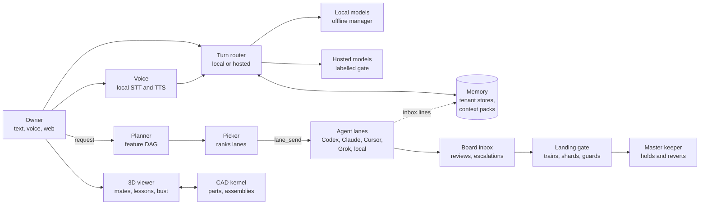

# Kyra

Kyra is a personal AI system that runs on one owner's machines. It has a long-term memory and a team of AI coding agents that a Board and planners coordinate. Hosted and local models sit behind a router with a spend cap, and a landing gate merges agent work only after its tests pass. Kyra also has a local voice pipeline, a 3D viewer with an animated bust of herself, and a CAD kernel.

This repository holds the parts of Kyra that carry no personal data, with their tests. It is a set of components taken out of a larger private application, so some seams that need the private parts refuse instead of running. Each part has its own README.



| Part | What it does | README |
|---|---|---|
| Memory | Versioned, tenant-isolated memory with budgeted context packs and real erasure | [packages/kyra-memory](packages/kyra-memory/README.md) |
| Agent team | Feature DAGs, lane picking, file leases, sending work to agent CLIs, the Board inbox, QC rules, agent audit | [parts/agent-team](parts/agent-team/README.md) |
| Models and routing | Turn router, labelled hosted request gate, spend cap, local model manager, model-free decision gates | [parts/models](parts/models/README.md) |
| Landing gate | Queue, trains, test shards across machines, the merge gate, master keeper | [parts/landing](parts/landing/README.md) |
| Voice | Local speech to text and text to speech, push to talk and VAD capture, the spoken register | [parts/voice](parts/voice/README.md) |
| 3D | three.js viewer, a mate solver in Python and JS, gear and flow lessons, the Blender bust | [parts/3d](parts/3d/README.md) |
| CAD | Part spec validation, a 2D sketch solver, build123d builds to GLB and STEP, drawings, assemblies | [parts/cad](parts/cad/README.md) |

## Tests

Python 3.11 or newer, from the repository root:

```sh
python -m venv .venv
. .venv/bin/activate
python -m pip install -e '.[test,cad]'
python -m pytest -q -n 2
```

On macOS with Git, Node and the CAD dependencies installed, the whole suite gave 2542 passed and 25 skipped. Each part README has a narrower command.

## What is not here

The owner's data, settings, keys and private documents, and every feature that handles personal records, stay in the private repository. So do the web app backend, the dispatcher loop that runs the agent team, and the private release policy. In this package the default hosted request gate refuses to send, and the local task catalogue raises an error saying it is not included. Some code paths read files under a data directory at run time; tests point that directory at a temporary folder.

## License

[MIT](LICENSE)
