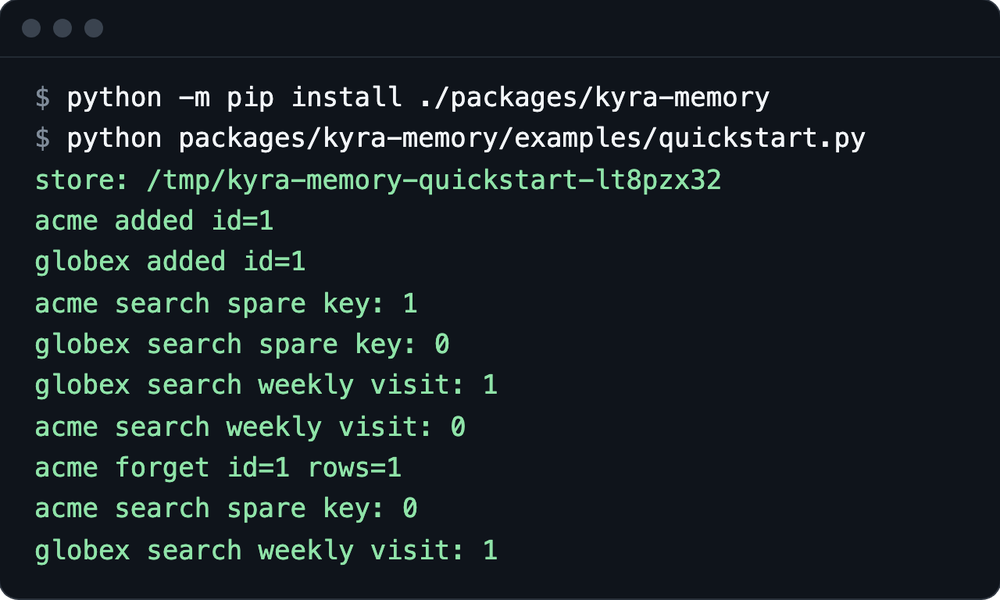
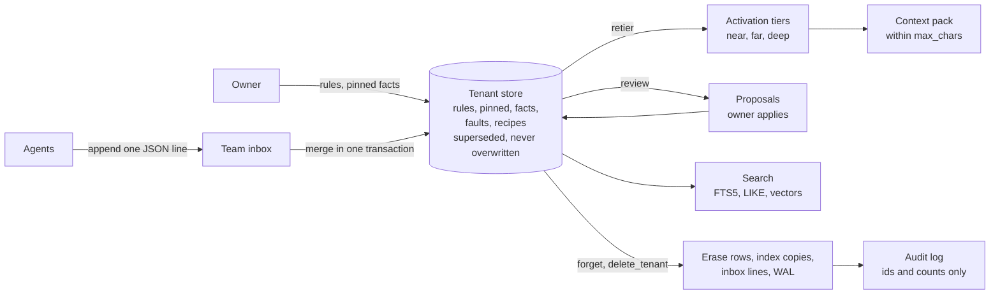

# Kyra Memory

**What it is.** A memory store for AI agents: it decides what to keep, lets memories fade by use instead of deleting them, finds them by keyword, full text or vector, keeps each tenant in its own file, and erases on request with an audit log that never holds the text.

**Why it matters.** Agent memory is user data. Stale facts mislead agents, and one tenant's rows must never reach another tenant's prompt. A delete that leaves copies in an index, a log or a WAL file leaves the data on disk. This package puts those rules in code and tests.

**Proof.** From a fresh clone and a new virtual environment, the memory tests give **244 passed, 26 skipped** (the skips need PostgreSQL). The [quickstart](#quickstart) needs nothing installed except this package, and it prints the isolation and erasure checks below.





## Quickstart

Python 3.11 or newer. From the repository root:

```sh
python -m venv .venv
. .venv/bin/activate
python -m pip install ./packages/kyra-memory
python packages/kyra-memory/examples/quickstart.py
```

Output (the first line is a temporary directory that changes per run):

```text
store: <temporary directory>
acme added id=1
globex added id=1
acme search spare key: 1
globex search spare key: 0
globex search weekly visit: 1
acme search weekly visit: 0
acme forget id=1 rows=1
acme search spare key: 0
globex search weekly visit: 1
```

Two synthetic tenants each add one fact. Each finds its own fact and not the other's. After `acme` forgets its fact, the search returns nothing and `globex` is untouched. Two more examples:

```sh
python packages/kyra-memory/examples/forget_and_audit.py   # ends with "audit holds body text: 0"
python packages/kyra-memory/examples/search_many.py        # 50 synthetic rows, five searches
```

Tests use the repository's shared test setup, so they need the repository install:

```sh
python -m pip install -e '.[test]'
python -m pytest -q tests/kyra_memory tests/test_kyra_memory_*.py
```

## Key design ideas

1. **Agents never write the store.** An agent appends one line to its team inbox; a background merger applies new lines and saves its byte offset in the same transaction, so after a crash no line is lost or applied twice. [`inbox.py`](../../src/kyra_memory/inbox.py)
2. **History is kept, with two clocks.** A correction supersedes the old row instead of overwriting it; `event_time` says when something was true and `knowledge_time` when the store learned it, so `as_of` answers "what did we believe at time T". [`store.py`](../../src/kyra_memory/store.py)
3. **Activation ranks; it never deletes.** The score is a pure function of how recently and often the owner recalled an item (agent inclusions count zero) and its links; rules and pinned facts stay in the near tier, and a discard is only a proposal with a 30 day hold. [`activation.py`](../../src/kyra_memory/activation.py), [`tiers.py`](../../src/kyra_memory/tiers.py)
4. **Review proposes, the owner decides.** Periodic reviews write proposals and change nothing until `apply()`; a downgrade of protected memory needs `owner_confirmed=True`. [`review.py`](../../src/kyra_memory/review.py)
5. **Outcomes move fact weights slowly.** A fact that keeps misleading ranks lower: weights stay in 0.7 to 1.3, need 5 outcomes, and move at most 0.05 per run. [`reweight.py`](../../src/kyra_memory/reweight.py)
6. **Context packs fit a size budget.** Rules, pinned facts, the team's often used items, facts, faults and one recipe go in that order; a row that does not fit is skipped whole rather than cut, and the final length is checked in code. Rows above a release policy's label are left out. [`assembler.py`](../../src/kyra_memory/assembler.py)
7. **Tenant isolation is structural.** SQLite keeps one file per tenant; the id is validated before any path is built, symlinks are refused and `ATTACH` is denied. The PostgreSQL backend uses row level security and refuses to run as a superuser or `BYPASSRLS` role. [`tenancy.py`](../../src/kyra_memory/tenancy.py), [`pg_backend.py`](../../src/kyra_memory/pg_backend.py)
8. **Erasure removes the bytes.** `forget` deletes the whole supersede chain, scrubs vector, inbox and hot file copies first, then uses `secure_delete`, `VACUUM` and a WAL truncate; a test checks that a marker string is gone from every database file. [`sqlite_backend.py`](../../src/kyra_memory/sqlite_backend.py), [`purge.py`](../../src/kyra_memory/purge.py), [test](../../tests/kyra_memory/test_kyra_memory_contract.py)
9. **Audit without the data.** A wrapper around any backend logs every call with ids and counts, never body text, and withholds or refuses rows above a tenant's privacy label. Per tenant quotas cap rows, bytes, writes per minute and age. [`audit.py`](../../src/kyra_memory/audit.py), [`policy.py`](../../src/kyra_memory/policy.py)

Every backend implements one [storage interface](../../src/kyra_memory/backend.py), and the same contract tests run against each.

## What is next

- Run the PostgreSQL contract tests against a live database. The backend and its tests exist; this release reports no PostgreSQL result.
- Publish load and vector search numbers from the included harnesses ([`bench/load.py`](../../src/kyra_memory/bench/load.py), [`bench/vectors.py`](../../src/kyra_memory/bench/vectors.py)) with the machine and method stated. No numbers are claimed here yet.
- Add an approximate nearest neighbor index; vector similarity today is computed exactly for every candidate row.

## License

[MIT](../../LICENSE)
