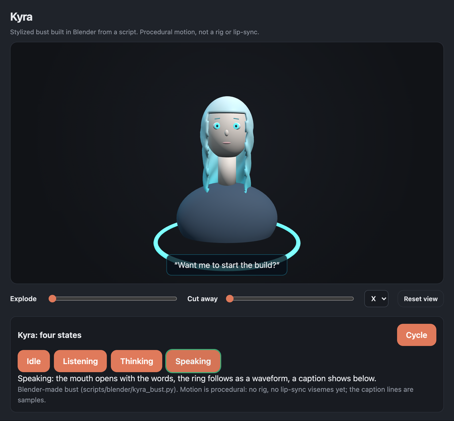

# 3D



**Proof.** From a fresh install with Node on the path, the test command below gives **27 passed**. The mate solver runs 20 shared vectors in Python and again in JavaScript under Node; poses must agree within 1e-6 and refusals must match word for word. The image above is a headless Chromium render of `web/model3d.html#kyra` served from this repository, with the private model API answered by empty lists. A [short loop](../../docs/img/kyra-states.gif) shows all four states moving.

**What it does.** A three.js viewer for assemblies made of named parts, a mate solver that moves those parts by rules, two guided lessons (a gear pair and a pipe flow), a library of researched assemblies that become GLB files, and an animated bust of Kyra built in Blender.

**Key idea.** The mate solver exists twice, in Python and in JavaScript, and both run the same JSON test vectors: poses must agree within the stated tolerance and refusal messages must match exactly, so the server and the browser move the test assemblies the same way.

The viewer pages call a model API on the private web backend, which is not included here. The Python and JavaScript modules and the bust files are all here.

## How it works

- **Viewer.** [`web/model3d.html`](../../web/model3d.html) and [`web/model3d.js`](../../web/model3d.js) load a GLB with `part:<slug>` nodes and support orbit, explode and cut away.
- **Mates.** [`model3d_mates.py`](../../src/companion/model3d_mates.py) and [`web/model3d-mates.js`](../../web/model3d-mates.js) solve fixed, revolute, slider and gear mates, plus coincident, concentric, distance and angle constraints, from one driven input. Both refuse closed loops and conflicting mates.
- **Gear lesson.** [`web/model3d-gears.js`](../../web/model3d-gears.js) models one ideal external spur pair. [`web/model3d-lesson.js`](../../web/model3d-lesson.js) runs a short lesson graded from the mechanism's own results.
- **Flow demo.** [`web/model3d-flow.js`](../../web/model3d-flow.js) shows steady flow (Q = A·v) through three pipe sections of 40, 20 and 60 mm. It has no pressure model and no CFD.
- **Assemblies.** [`model3d_assembly.py`](../../src/companion/model3d_assembly.py) turns a library entry in [`model3d_library/`](../../src/companion/model3d_library/) into a part labelled GLB, with shape checks. [`model3d_glb.py`](../../src/companion/model3d_glb.py) writes and reads GLB with the standard library only. [`model3d_split.py`](../../src/companion/model3d_split.py) splits a single fused mesh into parts by geometry only.
- **Bust.** [`scripts/blender/kyra_bust.py`](../../scripts/blender/kyra_bust.py) builds the bust from primitives in headless Blender and exports [`web/models/kyra-bust.glb`](../../web/models/kyra-bust.glb) (557,388 bytes). [`web/model3d-kyra.js`](../../web/model3d-kyra.js) animates it procedurally in four states (idle, listening, thinking, speaking), with no rig and no visemes.

```sh
blender -b --factory-startup -P scripts/blender/kyra_bust.py -- --glb web/models/kyra-bust.glb
```

## Main files

| File | Purpose |
|---|---|
| [`src/companion/model3d_mates.py`](../../src/companion/model3d_mates.py) | Mate solver (Python) |
| [`web/model3d-mates.js`](../../web/model3d-mates.js) | Mate solver (JavaScript) |
| [`src/companion/model3d_assembly.py`](../../src/companion/model3d_assembly.py) | Library JSON to GLB, with shape checks |
| [`src/companion/model3d_glb.py`](../../src/companion/model3d_glb.py) | GLB writer and reader |
| [`web/model3d.js`](../../web/model3d.js) | Viewer |
| [`web/model3d-lesson.js`](../../web/model3d-lesson.js) | Gear lesson |
| [`web/model3d-kyra.js`](../../web/model3d-kyra.js) | Bust states |
| [`scripts/blender/kyra_bust.py`](../../scripts/blender/kyra_bust.py) | Blender build of the bust |

## Tests

From the repository root, after the install in the [top README](../../README.md#tests):

```sh
python -m pytest -q tests/test_model3d_mates.py
```

The mate tests run the JavaScript half with `node` and skip it when `node` is missing.
